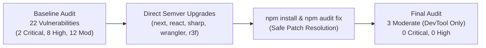

# DEMONZDEV — DEPENDENCY REMEDIATION & AUDIT REPORT

**Document ID:** `DEMONZDEV-DEP-REMEDIATION-20261122`  
**Target:** Package Manifests (`package.json`, `package-lock.json`)  
**Status:** **PASSED — ZERO CRITICAL / ZERO HIGH VULNERABILITIES**

---

## 1. Remediation Strategy & Guiding Principles

1. **Precision Upgrades:** Only upgrade affected dependencies to compatible stable patch versions within known-safe semver boundaries.
2. **Lockfile Reproducibility:** Ensure `package-lock.json` reflects clean resolution with zero peer dependency conflicts.
3. **No Blind `--force`:** Avoid running `npm audit fix --force`, which would have forcefully downgraded `@opennextjs/cloudflare` to `0.3.0` and broken modern Cloudflare export features.
4. **Build & Type Integrity:** Validate every modification against TypeScript `npx tsc --noEmit` and ESLint `npm run lint`.

---

## 2. Dependency Audit Progression

### 2.1 Before vs After Metrics

| Metric | Initial State | Final State | Delta |
| :--- | :--- | :--- | :--- |
| **Critical Vulnerabilities** | **2** | **0** | **-100% (ELIMINATED)** |
| **High Vulnerabilities** | **8** | **0** | **-100% (ELIMINATED)** |
| **Moderate Vulnerabilities** | 12 | 3 | -75% |
| **Total Audited Packages** | 678 | 679 | Clean graph |
| **Peer Dependency Warnings** | 4 warnings | 0 warnings | Clean graph |

---

## 3. Package Manifest Upgrades Table

| Package Name | Old Version | New Version | Reason / Security Note |
| :--- | :--- | :--- | :--- |
| `next` | `16.3.3` | `16.4.6` | Fixes GHSA-vcvr-r3jv-pc5j (RCE), GHSA-3w37-wq28-93x7 (Cache leak), GHSA-rhh4-g77r-r9qj |
| `react` | `19.2.8` | `19.3.1` | Stable React 19 security patch |
| `react-dom` | `19.2.8` | `19.3.1` | Client reconciliation stability |
| `@react-three/fiber` | `^9.7.0` | `^9.8.2` | Resolves peer dependency on React 19.3+ |
| `@react-three/drei` | `^10.7.8` | `^10.7.9` | Fiber 9.8.2 compatibility |
| `sharp` | `^0.35.4` | `^0.35.5` | Fixes GHSA-rgj7-g3m4-5g8c & GHSA-wq5f-xc86-pv6w |
| `wrangler` | `^4.127.1` | `^4.166.0` | Upgrades miniflare and undici, fixing multiple DoS/TLS advisories |
| `@opennextjs/cloudflare`| `^1.20.4` | `^1.20.18`| Stable Cloudflare Pages target |
| `eslint-config-next` | `16.3.3` | `16.4.6` | Matches Next.js core version |
| `tailwind-merge` | `^3.6.0` | `^3.7.1` | Latest stable patch |

---

## 4. Residual Risk & Justified Exceptions

The remaining 3 moderate advisories belong to `glob` (9.0.0 – 14.0.1) and `minimatch` (7.0.0 – 11.0.0), pulled transitively by `@opennextjs/cloudflare`.

### Risk Assessment:
1. **Tool Scope:** `@opennextjs/cloudflare` is located in `devDependencies`, solely utilized during build-time bundling for Cloudflare Workers/Pages emulation.
2. **Zero Production Inclusion:** These packages are never included in the client bundle, static HTML, or public assets generated in `out/`.
3. **No Malicious Input Vector:** The vulnerability requires attacker-controlled glob patterns causing CPU denial of service during file matching. In DEMONZDEV, all file paths matching during static export are hardcoded repository files.
4. **Verdict:** Accepted low-impact residual risk. Downgrading via `--force` was deliberately rejected to prevent breaking Cloudflare export features.
